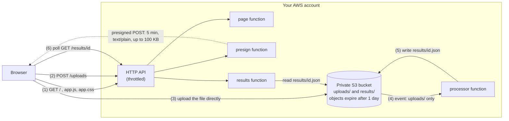

# Text fingerprint: a small, secure serverless demo


Upload a small `.txt` file and get its fingerprint. Here, this means its SHA-256, the word count, the number of unique words, the top 10 most used words, the average sentence length and the estimated reading time. The point is not the fingerprint, but how it is built. A browser uploads the txt file **straight to a private S3 bucket** using a short-lived link,
then S3 triggers a Lambda function that writes the result, and the page polls the API for it. It is
written with AWS CDK in Python, deploys into **your own AWS account** with a handful of `make`
commands, and removes itself completely with one more. The same pattern, a public and throttled API in front of private storage with event-driven processing, carries over to other back ends, such as a database in a private network.

## Architecture



Results are never served from S3 directly, the bucket has no public access, and the page and the
API share one origin (the API's), so there is no CORS rule beyond the one S3 needs for the upload.

### What it does

- **Direct-to-S3 uploads with a presigned POST:** 5-minute expiry, `text/plain` only, 1 byte to
  100 KB, and a server-generated random key, so the visitor never chooses where a file goes.
- **Event-driven, repeat-safe processing:** the output key is derived from the input key and the
  output depends only on the file's bytes, so S3 delivering an event twice is harmless.
- **Least privilege:** one IAM role per function, one S3 action per prefix, no `s3:ListBucket`
  anywhere, and log permissions limited to each function's own log group.
- **A strict browser page:** Content Security Policy without `'unsafe-inline'`, security headers,
  and every value shown through `textContent`, so a file containing `<script>` is just text.
- **Security gates in the build:** cdk-nag (AWS Solutions rules) and checkov must pass, and every
  exception has a written reason (see [Security](#security)).
- **Clean teardown you can verify:** nothing is left behind, and a script checks that.
- **A pure function at the core**, tested without AWS, with handlers as thin wrappers.

## What you need

**Supported platform: Linux.** It is tested on Ubuntu 24.04 by the CI workflow, whose GitHub-hosted
`ubuntu-24.04` runner is the reference environment. On Windows, the way to run it is WSL 2 with Ubuntu.

| Tool            | Version                       | Used for                                    |
| --------------- | ----------------------------- | ------------------------------------------- |
| Node.js         | a current LTS                 | the CDK command-line tool                   |
| AWS CDK CLI     | v2, pinned below              | synthesizes and deploys the stack           |
| uv              | pinned below                  | installs Python 3.14 and the dependencies   |
| Python          | 3.14 (uv installs it for you) | the app, the Lambda functions and the tests |
| AWS CLI         | v2, see the note below        | credentials, and the scripts' lookups       |
| make, git, bash | any recent                    | the commands below                          |

You also need an AWS account you may deploy into (see the next section).

**Pinned versions.** `requirements.txt` pins `aws-cdk-lib`, `constructs` and `cdk-nag` to
exact versions, so everyone builds the same stack. The CDK CLI is separate from that library and a
newer CLI works; an older one than the library needs will say so (see Troubleshooting). `make
install` also installs `botocore[crt]`: the helper scripts (`make baseline`, `make teardown-check`,
the access-log check) read your credentials through Python's AWS library, which needs that package
to use credentials created by `aws login`.

### Installing the tools

These are the standard Linux installs; each tool's own page is the authority if something has changed.
The versions below are the ones CI uses (`.github/workflows/check.yml`); a test keeps them in step.

```bash
# make, git, curl and unzip (Debian/Ubuntu; use your distribution's package manager otherwise)
sudo apt-get update && sudo apt-get install -y make git curl unzip

# uv, pinned to the version CI uses. It also downloads Python 3.14 when the project needs it.
# https://docs.astral.sh/uv/getting-started/installation/
curl -LsSf https://astral.sh/uv/0.12.23/install.sh | sh
```

To read the uv installer before running it, replace `| sh` with `| less`.

```bash
# AWS CLI v2 (on an ARM machine use awscli-exe-linux-aarch64.zip instead)
# https://docs.aws.amazon.com/cli/latest/userguide/getting-started-install.html
curl "https://awscli.amazonaws.com/awscli-exe-linux-x86_64.zip" -o awscliv2.zip
unzip awscliv2.zip
sudo ./aws/install

# clean up the download and the unpacked installer
rm -r awscliv2.zip aws
```

- **Version:** `aws login`, which this README recommends below, needs AWS CLI 2.32.0 or later.
- **Optional signature check:** the zip method is used because the download can be verified. The
  linked page describes checking `awscliv2.sig` against the zip with `gpg`; do that before `unzip`
  if you want the check.
- **Already have an older AWS CLI?** Update it as the linked page describes. Don't install over it.

**Node.js:** install the current LTS from <https://nodejs.org/en/download> (a version manager such
as nvm works too). The `nodejs` package in a distribution's own repositories is often too old, so
check with `node --version`. Then install the CDK command-line tool at the version CI uses; newer
versions usually work too:

```bash
npm install --global aws-cdk@2.1145.0     # with a system-wide Node.js, run this with sudo
```

Open a new shell afterwards so `~/.local/bin` (where uv installs) is on your `PATH`, then check
that everything is there:

```bash
make --version && git --version && uv --version && node --version && aws --version && cdk --version
```

What to look for: `aws-cli/2.32.0` or later, and `cdk` printing `2.1145.0` (a newer version
usually works). Node.js should be an LTS release.

## Before you start: use a sandbox

- **Use a sandbox or personal learning account, not a production one.** The stack creates IAM
  roles and a public API, and anything that costs money should be somewhere you can afford to
  lose track of.
- **Set a budget.** In the AWS console, open Billing, then Budgets, and create a small monthly
  budget (a few dollars) with an email alert. This demo costs almost nothing, but a budget is the
  safety net for any mistake, in this project or the next one.
- **Turn on account-level S3 Block Public Access** (S3 console, then "Block Public Access settings
  for this account"). The bucket in this stack already blocks public access; the account setting
  protects every other bucket you ever create.

## Cost

Everything is pay-per-request. There is **no** NAT gateway, load balancer, database, WAF or KMS key,
so nothing costs money while idle. Trying the demo a few times costs well under a dollar, and
mostly falls inside the free tier.

The API is public and has no login, so someone could send it traffic. The limits that cap that:

| Limit                                                        | Value                                    |
| ------------------------------------------------------------ | ---------------------------------------- |
| API throttle (whole API)                                     | 10 requests per second, bursts of 20     |
| `POST /uploads` (the only route that leads to storage and compute) | 1 per second, bursts of 2                |
| Upload size and type                                         | 1 byte to 100 KB, `text/plain`           |
| Presigned link lifetime                                      | 5 minutes                                |
| Stored objects                                               | deleted after 1 day                      |
| Lambda concurrency                                           | 2 per function (configurable, see below) |

Even if a script used the upload route at its limit all day, the estimate is **roughly a dollar a
day** (about 86,000 uploads, each costing a few S3 requests, a Lambda run and some log ingestion),
and it stops when you destroy the stack. Prices vary by region and over time; treat that as an
order of magnitude, not a quote.

**What `make destroy` leaves behind:** the stack and everything in it are deleted, including the
bucket and its contents and all log groups. What remains is outside the stack:

- the Lambda code packages (small zip files) in the CDK **bootstrap bucket**
  (`cdk-hnb659fds-assets-...`), uploaded when you deployed; and
- the `CDKToolkit` bootstrap stack itself, which is shared by every CDK project in that account and
  region and is not part of this demo.

## Step by step

Start by getting the code:

```bash
git clone https://github.com/oradell-computing/aws-cdk-secure-uploads.git
cd aws-cdk-secure-uploads
```

All commands from here on are run from the repository root, the directory you just entered.

### 1. Install

```bash
make install     # creates .venv with Python 3.14 and installs the dependencies
```

### 2. Check it (optional, needs no AWS access)

```bash
make check
```

This runs ruff, mypy, the unit tests, `cdk synth` with cdk-nag, a checkov scan of the generated
CloudFormation, and a search for anything that looks like an AWS account ID. All of it is local.
`ruff` and `checkov` always run at the versions pinned in the Makefile (through `uvx`, without installing
anything), whatever is installed on your machine, so your result matches CI's.
The same command runs on GitHub on every push to `main` and every pull request
(`.github/workflows/check.yml`), with no AWS credentials and no secrets.

### 3. Choose the account and region

By default the demo goes to **whatever account your AWS credentials point at**, in the region
from `REGION`, then `AWS_REGION`/`AWS_DEFAULT_REGION`, then your AWS CLI configuration. Nothing is
hardcoded in the repository. Pick one of these:

```bash
# Use the credentials and default region you are already logged in with
aws sts get-caller-identity

# Or name a profile and region on each command
make deploy PROFILE=my-profile REGION=us-east-1
```

Not logged in yet? Use **`aws login`** (it needs a recent AWS CLI, see "Installing the tools") or **`aws configure sso`**, then
`aws sts get-caller-identity` to confirm which account you are about to use. Both give short-lived
credentials that expire on their own, whereas plain `aws configure` saves a long-term access key and
secret in a file on your disk, which stays valid (and stealable) until you delete it.

If you run `cdk` yourself instead of through `make`, pass the target as CDK context:
`cdk deploy -c account=<your-12-digit-id> -c region=<region>`. The Makefile does this for you with
the values it prints, so what you confirm is exactly what CDK uses.

### 4. Bootstrap (once per account and region)

```bash
make bootstrap
```

CDK needs a small set of supporting resources (the bootstrap stack and bucket) before the first
deploy. It prints the account and region and asks you to type the account ID to confirm. Skip this
if the account and region are already bootstrapped.

### 5. Record a baseline (needed for step 9)

```bash
make baseline
```

This saves the list of resources that already carry the tag `project=demo-serverless`, so that the
teardown check in step 9 can tell "left behind by the demo" from "was already there". **Run it
before the first deploy; if you skip it, skip step 9 as well.** Like `deploy`, it works out the
account and region from your credentials and prints them (it only reads). The file goes in
your home directory (`BASELINE=path` to change it) because it contains account IDs. The script
refuses to write it inside the repository, and `*baseline*.txt` is in `.gitignore`. **Never commit
it.**

**Deploying a second time?** Your baseline file is still there, and `make baseline` **never
overwrites** it: it stops before calling AWS and tells you so. That is fine. If `make teardown-check`
passed after the last destroy, the existing baseline is still the right one, so skip this step and
run `make deploy`. To start over, delete the file yourself (or use `BASELINE=<another path>`), but only
once nothing from the demo is left in the account: a baseline recorded while leftovers exist counts
them as normal and hides them from the teardown check.

### 6. Deploy

```bash
make deploy
```

This shows the changes CDK is about to make, prints the target account and region, and waits for
you to type the account ID. Then CDK deploys. **CDK will also stop and ask you to approve the IAM
changes.** That is expected and is a safety feature, so read them and answer `y`. A first deploy
takes about a minute. The output includes `SiteUrl`.

### 7. Try it

Open the `SiteUrl` in a browser, choose a `.txt` file of up to 100 KB, and press the button. You
should see the fingerprint within a few seconds. Try a file over 100 KB, a file that isn't text, or
one containing `<script>alert(1)</script>`: each is rejected or shown harmlessly.

If you open the browser's developer console while you do this, you should see **no CSP or CORS
errors**. You will see **one `404` for `favicon.ico`**, and that is expected: browsers ask for it
automatically, and the page has no icon. The API deliberately serves only the page, its script and
stylesheet, and the two JSON routes, and the Content Security Policy allows nothing else, so there is
no route or policy exception for it. Any other console error is worth investigating.

Then run the automated end-to-end test:

```bash
make smoke
```

It checks the page and its security headers, the full upload flow (including CORS), the fingerprint
against a hash it computes itself, the error cases, and that the bucket is not publicly readable.
It requests several upload links at the API's 1-per-second limit, so it takes under a minute.

It then runs `scripts/access_log_check.py`, which waits (up to two minutes) for the API's **access
logs** to show up in CloudWatch Logs and checks their contents. HTTP API access logging can fail
silently, with the stage created and every request working while nothing is delivered, so this
proves it. If nothing arrives, it prints what the stage and your account actually have configured.
`make access-log-check` runs just that part.

### 8. Destroy

```bash
make destroy
```

Prints the account and region, asks you to type the account ID, then deletes the stack. The bucket
is emptied automatically.

### 9. Verify the teardown

```bash
make teardown-check
```

Prints the account and region it is reading (the same ones `deploy` used), then checks that the stack is gone, that no resources tagged `project=demo-serverless` exist beyond your
baseline, and that no log groups or IAM roles with the stack's name remain. It exits non-zero if it
finds anything. The AWS tagging API can lag by a few minutes after a delete, so if only the tag
check fails, wait and run it again. The same baseline works for later deploy and destroy cycles.

### Make targets

| Target                  | What it does                                                 |
| ----------------------- | ------------------------------------------------------------ |
| `make install`          | Python 3.14 virtualenv and dependencies                      |
| `make check`            | all the offline checks                                       |
| `make bootstrap`        | one-time CDK setup (asks for confirmation)                   |
| `make baseline`         | record already-tagged resources before the first deploy      |
| `make deploy`           | diff, confirm account and region, deploy                     |
| `make smoke`            | end-to-end test of the deployed stack, then the access-log check |
| `make access-log-check` | wait for the API's access logs to arrive and check them      |
| `make destroy`          | confirm account and region, delete everything                |
| `make teardown-check`   | verify nothing is left behind                                |

Optional variables: `PROFILE`, `REGION`, `RESERVED_CONCURRENCY`, `BASELINE`. None has a default
that depends on anyone's machine.

## If your Lambda quota is very small

By default each function reserves 2 units of Lambda concurrency, so that a burst of traffic to one
function can't use up the whole account's quota. New AWS accounts often have a total quota of only
**10**, and Lambda insists that part of the quota stays unreserved, so the deploy fails with an
error mentioning reserved concurrency. In that case turn reservations off:

```bash
make deploy RESERVED_CONCURRENCY=0
```

(For plain `cdk`: `-c reserved_concurrency=0`.) The functions still work; they just share the
account's pool. You can check your quota with
`aws lambda get-account-settings --query AccountLimit.ConcurrentExecutions`. Any other value from 1
to 100 is accepted, and anything else is rejected with a clear message before synthesis.

## Security

The security checks are part of the build, not a separate step: `cdk synth` fails if cdk-nag's
AWS Solutions rules find anything that isn't acknowledged, and `checkov` scans the generated
CloudFormation. Nothing is suppressed in bulk. Each exception is on a specific resource, has a
written reason in the code (`demo_serverless/demo_serverless_stack.py`), and is listed here with what
a production system would do instead.

### Acknowledged in cdk-nag

| Rule                                    | Where                                                        | Why it is acceptable here                                    | In production                                                |
| --------------------------------------- | ------------------------------------------------------------ | ------------------------------------------------------------ | ------------------------------------------------------------ |
| `AwsSolutions-IAM5` (wildcards)         | the presign, processor and results roles: `uploads/*`, `results/*` | Object keys are random ids that can't be listed in advance, so a prefix is the narrowest possible resource. One action per statement, nothing at bucket level, no `s3:ListBucket`. | Same, or one prefix per tenant or user.                      |
| `AwsSolutions-S1` (bucket access logs)  | the bucket                                                   | Access logs need a second bucket with its own retention and teardown. Objects are random-named and deleted after a day, and Lambda logs name every processed key. | Server access logs or CloudTrail data events to a locked-down log bucket. |
| `AwsSolutions-APIG4` (no authorization) | all 5 routes                                                 | A public demo with no user accounts. Abuse is limited by throttling, 5-minute links, the size limit and 1-day expiry. | Put authorization on the API: Cognito or a JWT authorizer, IAM, or a custom authorizer; and add AWS WAF with per-client rate limits. |

### Skipped in checkov

| Check                                           | Where                                                        | Why it is acceptable here                                    | In production                                                |
| ----------------------------------------------- | ------------------------------------------------------------ | ------------------------------------------------------------ | ------------------------------------------------------------ |
| `CKV_AWS_18` (access logging)                   | the bucket                                                   | Same as `S1` above.                                          | Same as `S1`.                                                |
| `CKV_AWS_21` (versioning)                       | the bucket                                                   | The data is disposable and expires in a day; versions would only keep deleted and overwritten copies. | Versioning with a lifecycle rule for old versions, wherever the data matters. |
| `CKV_AWS_116` (dead-letter queue)               | all functions                                                | The three API functions are synchronous, so API Gateway returns their errors. The processor has no DLQ by decision: failed events are retried twice and logged, and the page shows "processing failed or timed out". CDK's two helper functions are managed by CDK. | An SQS dead-letter queue or on-failure destination on the processor, with an alarm. |
| `CKV_AWS_117` (VPC)                             | all functions                                                | They only call AWS APIs and have no private resources to reach. A VPC would need NAT or endpoints, which cost money every hour. | A VPC if functions need private databases or services.       |
| `CKV_AWS_173` (environment variable encryption) | the four functions                                           | The variables are the bucket name and its public URL. There are no secrets. | A KMS key if any value is sensitive, and Secrets Manager for real secrets. |
| `CKV_AWS_158` (log group KMS)                   | all 7 log groups                                             | CloudWatch Logs already encrypts at rest. A customer-managed key adds a monthly cost and a deletion waiting period after destroy. | A customer-managed KMS key where policy requires it.         |
| `CKV_AWS_115` (reserved concurrency)            | CDK's two helpers always; our four functions only if you set `RESERVED_CONCURRENCY=0` | The helpers are created by CDK, run only during deploy and destroy, and offer no concurrency setting. | Reserve concurrency (or use provisioned concurrency) for production functions. |

### One role cdk-nag does not look at

CDK's bucket-emptying helper (the one that makes `auto_delete_objects` work) has a role that uses
the AWS managed policy `AWSLambdaBasicExecutionRole`. cdk-nag does **not** report that: it checks
IAM roles of one construct type and CDK builds this one as another, so the rule never runs on it.
That is a blind spot in the tool, not approval of the role, so it is handled by hand. The role can't
be replaced, so it carries an inline explicit deny of `logs:CreateLogGroup` (otherwise Lambda could
recreate a log group after it was deleted and leave an orphan behind). A test pins all of this; the
reasoning is in `docs/DESIGN.md`.

### Other things worth knowing

- **Throttling is for the whole API, not per visitor.** HTTP APIs have no per-client limits or
  usage plans, so one noisy client can use up the limit for everyone and get them 429 responses.
  That caps cost, but it is not fairness.
- **CORS is not access control.** The bucket's CORS rule only lets the page read S3's reply. The
  real controls are the presigned policy (key, size, type, expiry) and the bucket being private.
- **A presigned link can be replayed until it expires** (5 minutes). Replays overwrite the same key,
  so storage does not grow, but each one is a request and a processor run, bounded by the limits.
- **`Content-Type: text/plain` is a label, not a check.** S3 can't inspect bytes. The processor
  decodes strictly as UTF-8 and rejects binary data, and nothing is ever executed or rendered as HTML.
- **Pending and permission errors look alike.** The results function has no `s3:ListBucket`, so S3
  reports a missing result as "access denied". Both are shown as "pending", and a real permission
  bug would end as a timeout. The function logs the S3 error code to tell them apart.

## Troubleshooting

| Symptom                                                      | Likely cause and fix                                         |
| ------------------------------------------------------------ | ------------------------------------------------------------ |
| `make deploy` says it could not read your AWS credentials    | You're not logged in, or the profile is wrong. Run `aws sts get-caller-identity` (add `--profile ...`). Pass `PROFILE=...`. |
| `No region found`                                            | Pass `REGION=...`, or set `AWS_REGION`, or run `aws configure set region <region>`. |
| An error mentioning the CDK bootstrap version, or `SSM parameter /cdk-bootstrap/... not found` | The account and region aren't bootstrapped, or are out of date: `make bootstrap`. |
| Deploy fails with an error about reserved concurrency        | Your Lambda quota is small. `make deploy RESERVED_CONCURRENCY=0`. |
| Deploy fails creating the API stage with an access-log or log-delivery error | The identity you deploy with needs CloudWatch Logs permissions (such as `logs:CreateLogDelivery`). Use an administrator role in a sandbox account. |
| `cdk` prints a long JavaScript stack trace                   | It comes from CDK's JavaScript engine underneath the Python code. Read the first line of the error (and the line of `app.py` or the stack file just below it in the Python traceback); the JavaScript frames rarely matter. |
| `make baseline`, `make teardown-check` or `make access-log-check` stop with "boto3 can't read your AWS credentials" | Your credentials come from `aws login`, which Python can only read with `botocore[crt]`. Run `make install` (it is in `requirements-dev.txt`). |
| `cdk` complains that the cloud assembly schema version is newer than the CLI supports | Your CDK CLI is older than `aws-cdk-lib`. Update it: `npm install -g aws-cdk@latest`. |
| `cdk` prints "N feature flags are not configured"            | A newer `aws-cdk-lib` added a feature flag that `cdk.json` doesn't set yet, so CDK keeps the old behavior. Run `cdk flags --unstable=flags` to see which. Flags can change the generated template, so compare `cdk diff` (or the synthesized template) before and after setting one. `cdk.json` already sets every flag of the pinned version. |
| `make smoke` fails only at the access-log check              | The stack works but access logs aren't arriving. The output shows the stage's logging settings, the log group's class, KMS key and its own resource policy (which should let `delivery.logs.amazonaws.com` write to it). Delivery can lag, so first run `make access-log-check` again in a minute. Otherwise make sure the identity that deployed has `logs:CreateLogDelivery`, `logs:PutResourcePolicy`, `logs:DescribeResourcePolicies` and `logs:DescribeLogGroups` (an administrator role does), then run `make access-log-check` again. |
| `make check` fails running `ruff` or `checkov`               | The Makefile runs them through `uvx`, so `uv` must be installed and able to download them (it needs network access the first time). |
| The page says "Processing failed or timed out"               | The processor didn't finish in 30 seconds. Look at its log group in CloudWatch Logs (name starts with `DemoServerlessStack-ProcessorLogs`). Also check the results function's logs for S3 access errors. |
| Upload fails in the browser with a CORS or CSP error         | Open the browser's developer console and read the message. Use the `SiteUrl` from the deploy output (the CORS rule allows that exact origin); don't open `index.html` as a local file. |
| `make teardown-check` reports tagged resources               | The tagging API can lag a few minutes after deletion. Wait and run it again. |
| `make teardown-check` says the baseline is missing           | Run `make baseline` **before** the first deploy, or pass `BASELINE=...`. |
| `make destroy` fails                                         | Run it again; if the bucket still has objects, they are removed automatically. If CloudFormation reports a resource it can't delete, the error names it. |

## Known limitations

- It is a **demo**: no authentication, global throttling, no WAF, no custom domain, and no
  alarms or dashboards.
- Plain-text files up to **100 KB**, **UTF-8** only. A file with no words in it is rejected.
- **Sentence counting is simple.** A sentence ends at `.`, `!` or `?` (a period between digits, like
  `3.14`, doesn't count). Abbreviations such as "e.g." are counted as sentence ends.
- Words are split on anything that isn't a letter or a digit, with apostrophes kept inside words;
  there is no language-specific handling (for example for Chinese or Japanese word breaks).
- Reading time assumes 200 words per minute.
- The last few log lines of CDK's two helper functions can be lost during `destroy` (this is the
  price of making sure no log group is left behind).
- Linux is the supported platform (Ubuntu 24.04 in CI); nothing else is tested.
- Only one stack per account and region is expected; the stack name is fixed.

## Project layout

```
app.py                         CDK entry point (account and region from context or credentials)
demo_serverless/               the stack, the suppressions (each with a reason), input validation
functions/                     the Lambda code and the page (functions/static)
scripts/smoke_test.py          end-to-end test of a deployed stack
scripts/teardown_check.py      checks nothing is left after destroy
scripts/access_log_check.py    checks the API's access logs are delivered
scripts/awsutil.py             shared helper for the scripts that call AWS
.github/workflows/check.yml    runs `make check` on GitHub, with no AWS credentials
tests/unit/                    unit tests: stack properties, handlers, the fingerprint function
docs/DESIGN.md                 design decisions and their reasoning
Makefile                       the commands above
```

## About

Built by Wick McLean as a portfolio project: a public, throttled API in front of private storage,
with event-driven processing, least-privilege IAM, security checks in the build and a verified
teardown. The same pattern extends to other back ends. For questions, or for freelance AWS and
serverless work, contact me through my GitHub profile: https://github.com/oradell-computing

## License

MIT. See [LICENSE](LICENSE).
